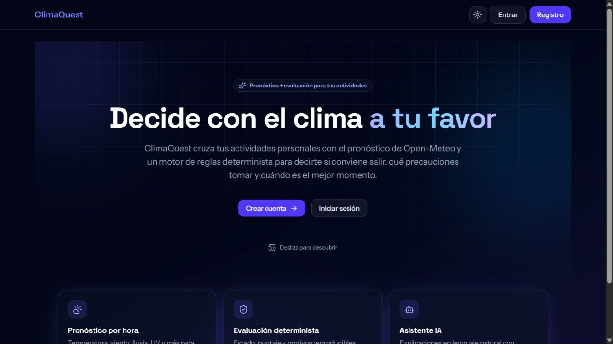
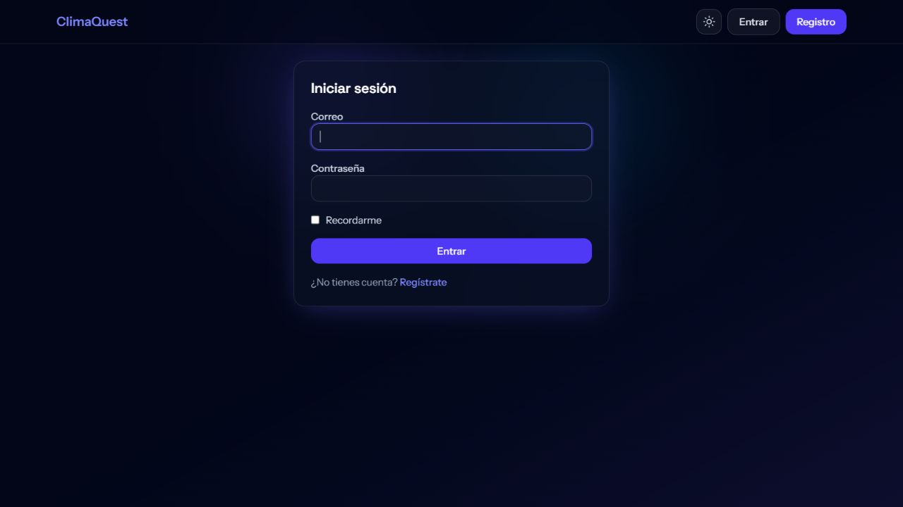

<p align="center"></p>
<p align="center"><strong>Decide con el clima a tu favor.</strong><br>Planifica actividades al aire libre con pronóstico, reglas explicables y asistencia opcional con IA.</p>

## El proyecto

ClimaQuest conecta una pregunta cotidiana —«¿cuándo conviene salir?»— con el lugar, horario y tipo de actividad de cada persona. Combina datos de Open-Meteo con un motor determinista para mostrar condiciones favorables, precauciones, riesgos o falta de información.

Está pensado para quienes corren, practican ciclismo, hacen senderismo, planean un día de playa o picnic, viajan o realizan fotografía exterior. Aborda tres problemas: consultar el clima separado de la agenda, interpretar variables sin contexto y reorganizar planes sin comparar alternativas horarias.

Como proyecto de portafolio, muestra una aplicación full stack con autenticación, recursos por usuario, integración de servicios externos, reglas reproducibles y componentes React integrados en vistas Blade.

## Capturas

Pantallas públicas de la aplicación ejecutada localmente, sin datos personales.





## Interfaces

| Pantalla | Funciones |
| --- | --- |
| Presentación | Explica la propuesta y permite acceder al registro o inicio de sesión. |
| Registro y acceso | Crea una cuenta e inicia una sesión personal. |
| Inicio / dashboard | Muestra el resumen meteorológico, la próxima actividad y recomendaciones. |
| Calendario | Organiza visualmente las actividades personales mediante FullCalendar. |
| Mis actividades | Permite consultar, crear, editar y eliminar actividades propias. |
| Nueva actividad | Define categoría, ubicación y horario; ofrece un generador para interpretar una solicitud y revisar propuestas antes de guardarlas. |
| Detalle | Presenta la evaluación, sus motivos y alternativas horarias. |
| Pronóstico | Consulta condiciones y detalle por horas: temperatura, sensación térmica, lluvia, viento y UV. |
| Historial | Lista evaluaciones anteriores, ordenadas por fecha y paginadas. |
| Asistente IA | Genera explicaciones, recomendaciones y precauciones para una actividad, con fuentes cuando estén disponibles. |

La interfaz incorpora temas claro y oscuro, búsqueda de ubicaciones y animaciones que contemplan la preferencia de movimiento reducido.

## Propuesta y alcance de la demo

**Propuesta del producto:** reunir agenda, clima y orientación contextual para ayudar a elegir cuándo realizar actividades al aire libre.

**Implementado:** autenticación por sesión, gestión de actividades por usuario, calendario, integración meteorológica, evaluación mediante reglas, alternativas, historial y asistencia contextual. Es una aplicación con backend Laravel y PostgreSQL; el repositorio no documenta un despliegue público.

**Opcional y dependiente de configuración:** OpenRouter necesita una clave para generar respuestas con un modelo. El asistente ofrece explicaciones deterministas cuando la IA no está configurada o falla. La recuperación de conocimiento (RAG) viene desactivada y requiere documentos aprobados; los embeddings y pgvector son opcionales y existe búsqueda por palabras clave. Open-Meteo requiere conectividad.

**Límites:** Configuración aparece como próxima función. El modelo de notificaciones no representa por sí solo un sistema terminado de alertas programadas. Los anexos describen objetivos y decisiones de diseño, no garantizan que todo esté implementado. La evaluación depende de la cobertura del pronóstico y no sustituye avisos oficiales ni garantiza condiciones seguras.

<details>
<summary><strong>Tecnologías y arquitectura</strong></summary>

| Capa | Tecnologías |
| --- | --- |
| Backend | PHP, Laravel 13, Eloquent, Blade y sesiones. |
| Frontend | React 19, Tailwind CSS 4, Vite 8 y Lucide. |
| Agenda y animación | FullCalendar 6, GSAP y Motion. |
| Persistencia | PostgreSQL, JSONB, snapshots y evaluaciones almacenadas. |
| Integraciones | Open-Meteo, OpenRouter y embeddings configurables. |
| Conocimiento | Markdown, búsqueda por palabras clave y pgvector opcional. |
| Desarrollo y calidad | PHPUnit 12, Laravel Pint y Laravel Boost. |

Las [rutas](routes/web.php) conectan controladores con servicios de [meteorología](app/Services/Weather), [evaluación](app/Services/Assessment) e [IA](app/Services/Ai). Los [componentes React](resources/js/components) se montan en [vistas Blade](resources/views).

Las reglas determinan el estado de una actividad; la IA aporta explicaciones. Esta separación conserva la evaluación reproducible y permite funcionar sin configurar un modelo.

</details>

<details>
<summary><strong>Instalación local</strong></summary>

### Requisitos

- PHP 8.4 o superior compatible con el lockfile y Composer 2. El manifiesto declara PHP `^8.3`, pero las dependencias bloqueadas requieren una versión más reciente.
- Node.js 22.12+ o 24 y npm.
- PostgreSQL y la extensión PHP `pdo_pgsql`. Las migraciones usan SQL específico; SQLite no sustituye este requisito.
- Internet para instalar dependencias, descargar fuentes durante la compilación y consultar servicios externos.

Desde la raíz del repositorio:

```sh
composer install
php -r "file_exists('.env') || copy('.env.example', '.env');"
php artisan key:generate
npm ci --ignore-scripts
```

Crea una base vacía `climaquest` y ajusta las variables `DB_*` en `.env` según [.env.example](.env.example). Conserva `DB_CONNECTION=pgsql`.

```sh
php artisan migrate
php artisan db:seed --class=ActivityCategorySeeder
php artisan db:seed --class=ActivityRuleSeeder
npm run build
php artisan serve
```

Abre la dirección indicada por Artisan y crea una cuenta desde Registro. Estos seeders cargan categorías y reglas, sin necesitar una cuenta compartida. Para desarrollo con recarga automática, ejecuta `npm run dev` en otra terminal.

### IA y conocimiento opcionales

Configura `OPENROUTER_API_KEY` y, si corresponde, `OPENROUTER_MODEL` en `.env`. Las claves permanecen en el servidor. Para RAG, revisa [docs/knowledge](docs/knowledge), activa `RAG_ENABLED=true` e ingiere los documentos que apruebes:

```sh
php artisan rag:ingest docs/knowledge --approve
php artisan config:clear
```

Sin embeddings se usa coincidencia por palabras clave. Para búsqueda vectorial, prepara pgvector antes de migrar y configura `EMBEDDINGS_*`; la columna actual usa 1536 dimensiones. La migración omite la parte vectorial si la extensión no está disponible.

</details>

<details>
<summary><strong>Pruebas</strong></summary>

La suite utiliza **PHPUnit**, aunque los anexos propongan Pest. [phpunit.xml](phpunit.xml) separa pruebas unitarias y funcionales y configura PostgreSQL con la base `climaquest_test`.

```sh
php artisan test --testsuite=Unit
```

Para la suite completa, crea una base exclusiva `climaquest_test` y configura sus credenciales y una `APP_KEY` válida en `.env.testing`. Las pruebas con `RefreshDatabase` recrean tablas: utiliza una base separada.

```sh
composer test
npm run build
```

Las [pruebas unitarias](tests/Unit) cubren agregación meteorológica, reglas y expansión de horarios. Las [funcionales](tests/Feature) cubren autenticación, autorización, CRUD, dashboard, integración meteorológica, generación de actividades, asistente e ingesta de conocimiento. Se incluyen respuestas HTTP simuladas y [fixtures](tests/Fixtures/open-meteo).

Estos comandos explican cómo verificar el proyecto; no certifican una cobertura concreta ni el éxito de la suite completa en todos los entornos.

</details>

<details>
<summary><strong>Documentación del diseño</strong></summary>

- [Anexo técnico v1.1](docs/ClimaQuest_Anexo_Tecnico_v1.1.md).
- [Anexo técnico v1.2](docs/ClimaQuest_Anexo_Tecnico_v1.2.md).
- [Base de conocimiento](docs/knowledge).

Los anexos explican la intención del producto. Para conocer el alcance ejecutable, consulta el código, las rutas y las pruebas de esta versión.

</details>
